<div align="center">


# HealthGuard AI

### An Agentic AI-Powered Personal Healthcare Intelligence Platform

**Dynamic Multi-Agent Orchestration • Clinical RAG • Longitudinal Health Monitoring • Medication Adherence • Explainable Risk Screening**

An AI-assisted personal healthcare intelligence platform that unifies structured physiological monitoring, retrieval-augmented generation (RAG) over clinical guidelines and user medical reports, medication adherence tracking, and bounded dynamic multi-agent orchestration into a privacy-aware, explainable clinical workspace.

[](https://www.python.org/)
[](https://fastapi.tiangolo.com/)
[](https://react.dev/)
[](https://www.typescriptlang.org/)
[](https://vite.dev/)
[](https://streamlit.io/)
[](https://ollama.com/)
[](https://groq.com/)
[](https://www.trychroma.com/)
[](https://www.sqlalchemy.org/)
[](#testing-and-verification)

</div>

---

## Table of Contents

- [Overview](#overview)
- [Application Interface & Screenshots](#application-interface--screenshots)
- [Core Capabilities](#core-capabilities)
  - [1. Dynamic Multi-Agent Orchestration](#1-dynamic-multi-agent-orchestration)
  - [2. Intelligent Health Monitoring & Longitudinal Analytics](#2-intelligent-health-monitoring--longitudinal-analytics)
  - [3. Clinical Retrieval-Augmented Generation (RAG)](#3-clinical-retrieval-augmented-generation-rag)
  - [4. Medication Management & Adherence Tracking](#4-medication-management--adherence-tracking)
  - [5. Explainable Risk Assessment & Experimental ML Screening](#5-explainable-risk-assessment--experimental-ml-screening)
  - [6. Notifications & Monitoring Events](#6-notifications--monitoring-events)
- [System Architecture](#system-architecture)
- [Dynamic Orchestration Workflow](#dynamic-orchestration-workflow)
- [Medical RAG Workflow](#medical-rag-workflow)
- [Technology Stack](#technology-stack)
- [Repository Structure](#repository-structure)
- [API Reference Summary](#api-reference-summary)
- [Privacy, Security, and Safety](#privacy-security-and-safety)
- [Getting Started](#getting-started)
- [Testing and Verification](#testing-and-verification)
- [Engineering Design Principles](#engineering-design-principles)
- [Current Limitations & Responsible Use](#current-limitations--responsible-use)
- [Author](#author)

---

## Overview

**HealthGuard AI** is a modular, full-stack healthcare intelligence platform engineered to transform fragmented personal health records into structured, traceable, and grounded insights.

Conventional health-tracking applications typically stop at logging physiological measurements or rendering static charts. HealthGuard AI bridges structured clinical data and generative AI by combining longitudinal statistical analysis, medication adherence scheduling, private PDF report indexing, clinical reference retrieval, and a **bounded dynamic multi-agent orchestrator** within a unified FastAPI + React architecture.

A foundational principle of the system is the strict separation between **deterministic clinical calculations** and **generative language model reasoning**:

- **Dynamic Agentic Orchestration:** An iterative **Decision → Execution → Observation** planner dynamically selects from allowlisted agent tools based on user intent, intermediate findings, and requested domain coverage—with automatic fallback to deterministic planning when local LLM services are offline.
- **Deterministic Measurements & Statistics:** Unit normalization, baseline-vs-recent window statistics ($z$-scores, absolute change, standard deviation), longitudinal trend slopes, and dose adherence percentages are computed deterministically in Python—never delegated to LLM guesswork.
- **Evidence-Grounded Clinical RAG:** Medical explanations are grounded in **3,197 indexed chunks** from seven approved clinical guidelines alongside user-uploaded PDF laboratory reports in isolated ChromaDB collections (`all-MiniLM-L6-v2`), complete with numbered source citations.
- **Privacy-First Local AI:** Inference runs locally by default via **Ollama (`llama3.1`)**, keeping personal physiological data and uploaded medical documents on the host machine.
- **Defense-in-Depth Safety Controls:** Pre-execution emergency screening, critical physiological threshold escalation, request-scoped tool/metric locking, JWT identity enforcement, and non-diagnostic response validation prevent unsafe autonomous actions.

> **Disclaimer:** HealthGuard AI is an educational, personal health-information management, and software-engineering demonstration platform. It is **not** a certified medical device and does not provide medical diagnosis, treatment authorization, or emergency triage.

---

## Application Interface & Screenshots

HealthGuard AI provides a modern, responsive **React + TypeScript + Vite** clinical workspace (alongside a preserved Streamlit dashboard) integrated with the FastAPI backend.

### 1. Overview Dashboard
Real-time physiological snapshot across blood glucose, heart rate, blood pressure, and daily steps, paired with active monitoring alerts and today's scheduled medication doses.

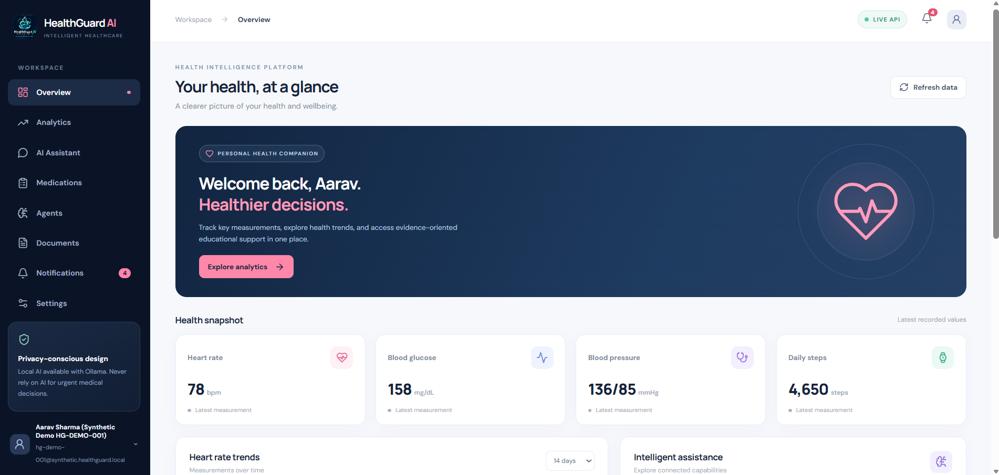

### 2. Health Analytics & Longitudinal Trends
Interactive multi-window trend charts (`7`, `14`, `30`, and `90` days), manual physiological measurement logging, blood pressure pairing, and bulk CSV health record import.

| Health Analytics Workspace | Multi-Metric Trend Visualization |
|---|---|
| 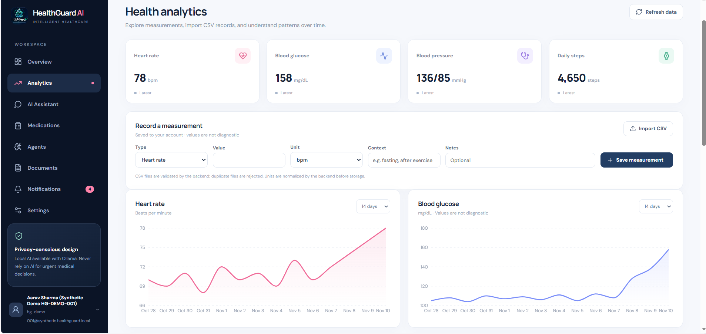 | 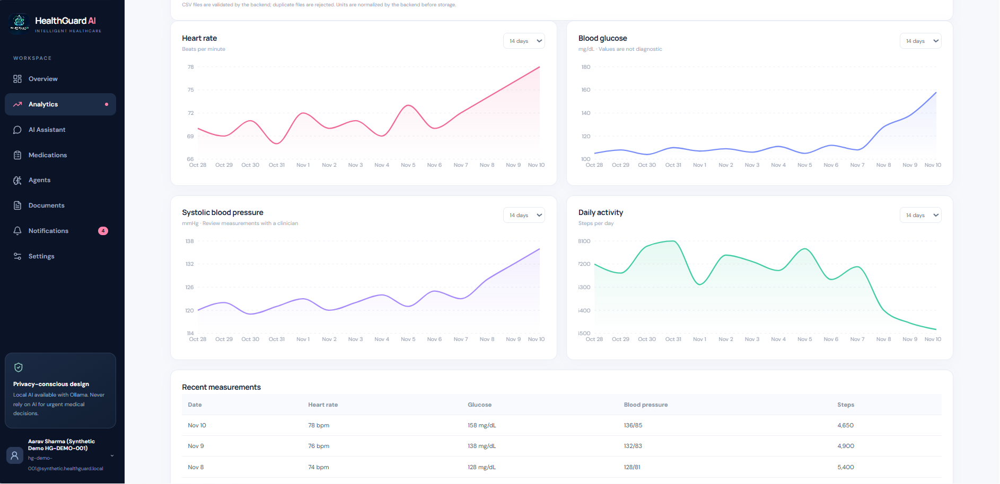 |

### 3. AI Medical Assistant (Clinical RAG)
Evidence-grounded medical question answering powered by local ChromaDB vector retrieval (`all-MiniLM-L6-v2`) and Ollama (`llama3.1`), displaying numbered source citations, user document context toggles, and explicit safety notices.

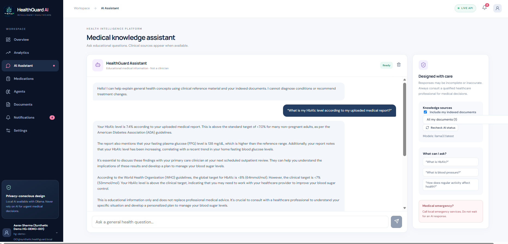

### 4. Medication Management & Adherence Tracking
Structured prescription management, daily recurring schedule configuration, real-time dose confirmation (`Take` / `Skip`), and longitudinal adherence analytics.

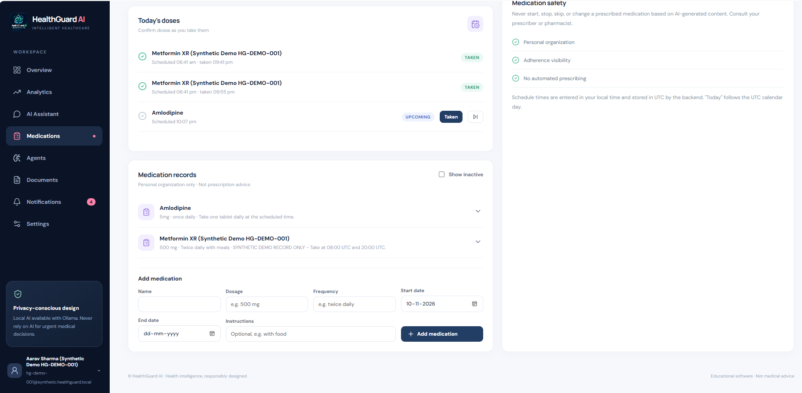

### 5. Agentic AI Workspace & Experimental Diabetes Screening (v3)
Dynamic natural-language agentic execution (`POST /orchestration/execute`) and predefined multi-agent workflows (`Comprehensive Assessment`, `Medication Check`, `Health Summary`) with step-by-step execution traces, planner mode indicators (`llm_assisted` vs `deterministic_fallback`), latency breakdowns, audit history, and an integrated **Experimental Diabetes Screening Model (v3)** panel (`/ml/diabetes/predict-v3`).

| Multi-Agent Orchestration Workspace | Experimental Diabetes Screening (v3) |
|---|---|
| 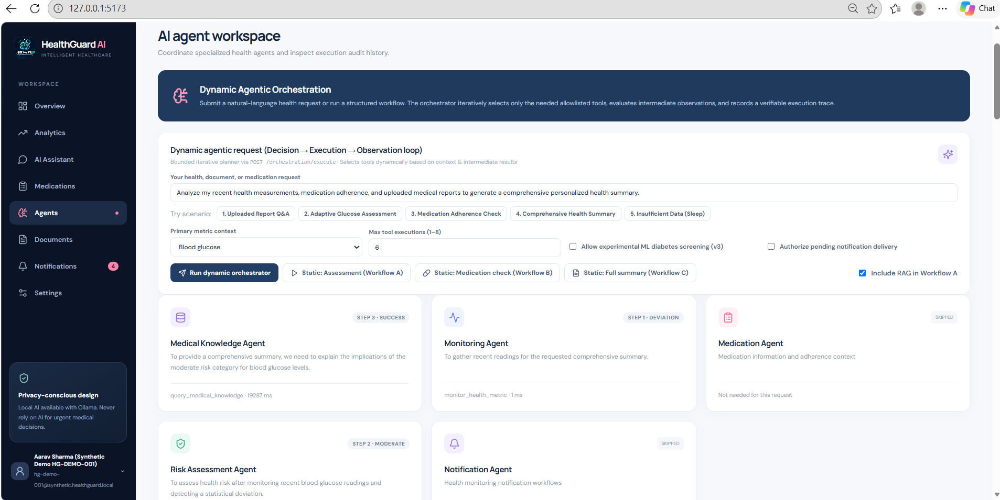 | 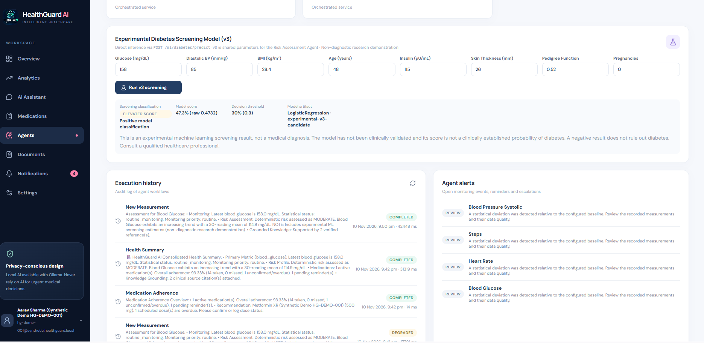 |

### 6. Medical Documents, Notifications & Workspace Settings
Private PDF clinical report upload with inline PDF viewing and isolated user vector indexing (`user_documents_<user_id>`), statistical deviation monitoring alerts, medication reminders, and live backend/RAG health diagnostics.

| Medical Documents & RAG Indexing | Notifications & Monitoring Events |
|---|---|
| 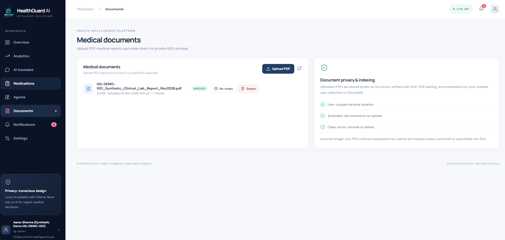 | 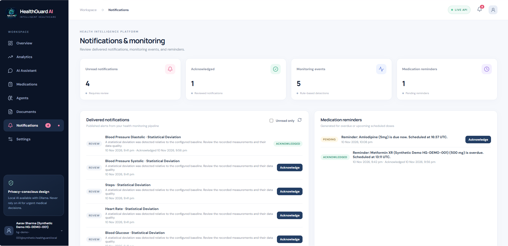 |

<div align="center">
  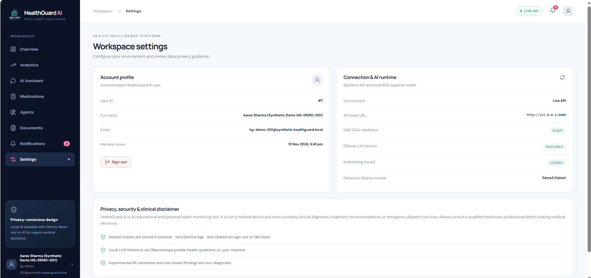
</div>

---

## Core Capabilities

### 1. Dynamic Multi-Agent Orchestration

At the core of HealthGuard AI is the `AgenticOrchestrator`, which coordinates five specialized domain agents through both a **Dynamic Agentic Execution Loop (`POST /orchestration/execute`)** and structured workflow endpoints.

| Specialized Agent | Allowlisted Tool(s) | Core Responsibility |
|---|---|---|
| **Monitoring Agent** | `monitor_health_metric` | Evaluates physiological readings against historical baselines and recent rolling windows; computes $z$-scores, detects statistical deviations, and flags critical physiological values. |
| **Risk Assessment Agent** | `assess_health_risk` | Performs 30-reading longitudinal trend analysis (`increasing`, `decreasing`, `unchanged`), assigns deterministic rule-based risk tiers (`low`, `moderate`, `high`, `critical`), and optionally runs experimental ML screening (`diabetes_v3`). |
| **Medication Agent** | `check_medication_adherence` | Evaluates active prescriptions, scheduled dose occurrences, adherence percentage, taken/missed/overdue counts, and read-only reminder candidates without ever modifying prescriptions. |
| **Medical Knowledge Agent** | `query_medical_knowledge` | Executes grounded RAG retrieval across global clinical guidelines and user-uploaded PDF medical reports, returning educational explanations and numbered source citations. |
| **Notification Agent** | `inspect_active_alerts`, `deliver_pending_notifications` | Separates read-only alert inspection (`inspect_active_alerts`) from side-effecting notification delivery (`deliver_pending_notifications`) with cooldown and duplicate suppression. |

#### Key Capabilities of the Dynamic Orchestrator:
- **Iterative Decision → Execution → Observation Loop:** Rather than classifying a prompt into a static template, the planner inspects the user's request, compact health context snapshot, and sanitized observations from prior steps to dynamically select the next tool (`max_steps` bounded up to 8, default 6).
- **Request-Scoped Tool & Metric Locking (`RequestToolScope`):** When a user asks about a specific vital sign (e.g., *"Assess my recent blood glucose measurements"*), the orchestrator locks monitoring and risk tools to `blood_glucose`, preventing LLM drift into unrelated vitals such as blood pressure or heart rate.
- **Explicit Domain Coverage Tracking:** The orchestrator extracts all requested task domains (`health_measurements`, `medication_adherence`, `medical_documents`) from the user prompt and blocks premature `FINISH` actions until every explicitly requested domain has been addressed (providing missing-domain feedback to the planner).
- **Dual-Mode Resilience (`llm_assisted` + `deterministic_fallback`):** Uses live Ollama (`llama3.1`) structured JSON planning when available and seamlessly falls back per step to deterministic policy rules if Ollama is unreachable or times out.
- **Structured 6-Part Grounded Synthesis & Telemetry:** Consolidates multi-agent outputs into clearly labeled sections (**Recorded Measurement**, **Statistical Deviation Analysis**, **Rule-Based Risk & Trend Classification**, **Medication Adherence**, **Uploaded Medical Document & Knowledge Findings**, and **General Educational Guidance**) alongside per-stage latency breakdowns (`planner_llm_ms`, `agent_execution_ms`, `rag_generation_ms`, `response_synthesis_ms`, `total_duration_ms`).

---

### 2. Intelligent Health Monitoring & Longitudinal Analytics

HealthGuard AI provides a structured environment for recording, normalizing, and analyzing physiological measurements:

- **Supported Metrics & Automatic Unit Normalization:**
  - `blood_glucose` (normalized to `mg/dL`, with automatic conversion from `mmol/L`)
  - `blood_pressure_systolic` & `blood_pressure_diastolic` (`mmHg`, including paired blood pressure entry)
  - `heart_rate` (`bpm`)
  - `weight` (`kg` / `lbs`)
  - `steps` (`count`)
- **Longitudinal Statistical Engine (`LongitudinalAnalyzer` & `TrendAnalyzer`):** Compares baseline windows against recent windows to calculate mean, standard deviation, absolute delta, direction of change, and statistical $z$-score deviations.
- **Automated Monitoring Triggers:** Recording a new metric automatically evaluates statistical deviations and critical physiological thresholds, generating deduplicated `MonitoringEvent` records.
- **Bulk CSV Ingestion:** Validated CSV import with duplicate detection, schema verification, and unit normalization.

---

### 3. Clinical Retrieval-Augmented Generation (RAG)

HealthGuard AI uses a local ChromaDB vector store and Sentence Transformers (`all-MiniLM-L6-v2`, 384-dimensional embeddings) to ground medical explanations in verifiable source material:

- **Global Clinical Knowledge Base (`medical_knowledge`):** Contains **3,197 indexed chunks** derived from seven clinical reference documents covering:
  - Diabetes prevention, diagnosis, classification, and glycemic management
  - Cardiovascular disease prevention and risk management
  - Hypertension clinical guidelines
  - World Health Organization (WHO) noncommunicable disease management
- **Isolated Personal Medical Documents (`user_documents_<user_id>`):** Users can upload PDF laboratory reports or clinical summaries. Text is extracted via PyMuPDF (`fitz`), chunked, embedded, and stored in a strictly isolated per-user ChromaDB collection.
- **Non-Diagnostic Grounding & Citation Validation:** Prompts enforce strict educational framing—statistical deviations and rule-based risk categories are never equated with clinical diagnoses (such as diabetes or hypertension), and numbered citations (`[1]`, `[2]`, ...) are validated against retrieved chunks.

---

### 4. Medication Management & Adherence Tracking

- **Prescription & Schedule Management:** Create, update, and deactivate medication records with dosage, frequency, and daily recurring times (`HH:MM`).
- **Deterministic Dose Scheduling (`MedicationScheduler`):** Automatically generates expected daily dose occurrences and tracks `pending`, `taken`, `missed`, and `skipped` states.
- **Adherence Analytics (`MedicationAdherenceService`):** Computes window-based adherence percentages, identifies overdue/unconfirmed doses, and powers both the Medication UI and `MedicationAgent`.
- **Safe Boundary:** Neither the backend services nor the AI agents can autonomously prescribe, alter dosages, or discontinue user medications.

---

### 5. Explainable Risk Assessment & Experimental ML Screening

HealthGuard AI maintains a strict architectural separation between **deterministic rule-based risk stratification** and **experimental machine-learning screening**:

1. **Deterministic Rule-Based Risk Stratification (`RiskAssessmentAgent`):**
   - Evaluates 30-reading longitudinal trajectories (`increasing`, `decreasing`, `unchanged`) and recent physiological thresholds to classify risk into `low`, `moderate`, `high`, or `critical`.
2. **Experimental Diabetes Screening Model (`v3` — `/ml/diabetes/predict-v3`):**
   - Verified via **SHA-256 artifact checksum** before loading (`diabetes_model_v3.pkl`).
   - Performs physiological range validation, zero-as-missing clinical imputation, and interaction feature engineering (`BMI_Age`, `Glucose_BMI`, `Insulin_Resistance_Proxy`) using a recall-oriented screening threshold (`0.40`).
   - Only invoked during agentic orchestration when `experimental_ml=true` is explicitly requested and sufficient physiological features are present.

---

### 6. Notifications & Monitoring Events

- **Event Classification & Deduplication:** Statistical deviations and threshold alerts are classified by priority (`routine`, `warning`, `urgent`, `critical`) and deduplicated within active cooldown windows.
- **Read-Only Inspection vs. Delivery:** In dynamic orchestration, `inspect_active_alerts` allows the agent to review unread notifications and active alerts without side effects, while `deliver_pending_notifications` is only invoked when the user explicitly requests notification dispatch.

---

## System Architecture

HealthGuard AI separates presentation, authenticated API routing, deterministic domain services, dynamic agentic orchestration, vector retrieval, and persistent storage into modular layers:

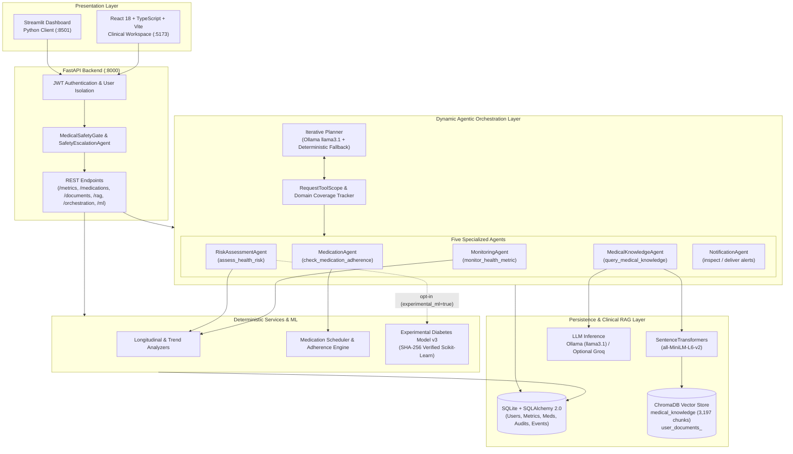

---

## Dynamic Orchestration Workflow

When a request arrives at `POST /orchestration/execute`, HealthGuard AI executes a bounded, auditable **Decision → Execution → Observation** loop:

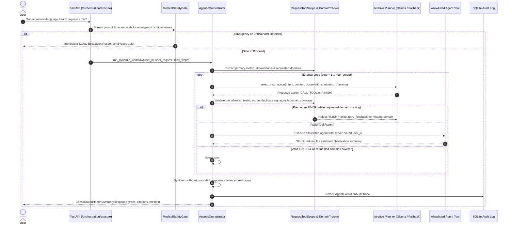

---

## Medical RAG Workflow

The retrieval-augmented generation pipeline ensures that clinical explanations are anchored in indexed medical literature and the user's own uploaded lab reports:

```text
User Question / Agent Knowledge Query
     |
     v
Request Validation & Non-Diagnostic Query Sanitization
     |
     v
Semantic Embedding Generation (SentenceTransformers: all-MiniLM-L6-v2)
     |
     +---> Global Collection: medical_knowledge (3,197 clinical guideline chunks)
     |
     +---> Private Collection: user_documents_<user_id> (Uploaded PDF lab reports)
     |
     v
Top-K Similarity Search + Prompt-Injection Pattern Filtering
     |
     v
Numbered Context Preparation ([1], [2], [3] with Source Metadata)
     |
     v
Local Ollama (llama3.1) / Configured LLM Generation (Bounded Token Budget)
     |
     v
Citation Identifier Verification + Post-Generation Medical Safety Validation
     |
     v
Grounded Educational Explanation + Traceable Source Citations
```

---

## Technology Stack

| Layer | Technology | Purpose |
|---|---|---|
| **Languages** | Python 3.10+, TypeScript 5.6 | Backend services, ML/RAG pipelines, and strongly-typed frontend UI |
| **Backend Framework** | FastAPI + Uvicorn + Pydantic v2 | REST API, request/response schema validation (`extra="forbid"`), OpenAPI docs |
| **Primary Web UI** | React 18, Vite 6, Tailwind CSS, Recharts, Lucide React | Interactive clinical workspace, longitudinal charts, and agent trace inspector |
| **Secondary UI** | Streamlit | Preserved Python analytical dashboard (`healthguard/dashboard/app.py`) |
| **Relational Database** | SQLite + SQLAlchemy 2.0 + Alembic | Persistent storage for users, metrics, medications, documents, events, and agent audits |
| **Authentication** | JWT (`python-jose` / `PyJWT`) + `bcrypt` | Stateless Bearer token authentication and strict per-user data isolation |
| **Vector Database** | ChromaDB (Persistent Client) | Isolated vector collections for global clinical guidelines and private user PDFs |
| **Embedding Model** | Sentence Transformers (`all-MiniLM-L6-v2`) | Deterministic 384-dimensional semantic embeddings for indexing and retrieval |
| **Document Parsing** | PyMuPDF (`fitz`) | PDF text extraction and page-aware chunking for uploaded clinical reports |
| **Local LLM Inference** | Ollama (`llama3.1`) | Privacy-preserving local LLM planning and RAG answer synthesis |
| **Optional Cloud LLM** | Groq API (`llama-3.3-70b-versatile`) | Opt-in cloud inference with explicit personal-data transmission guards |
| **Experimental ML** | Scikit-Learn + Joblib | SHA-256 verified diabetes screening pipeline (`diabetes_model_v3.pkl`) |
| **Testing** | Pytest + HTTPX `TestClient` | **379 automated unit, integration, security, and agentic orchestration tests** |

---

## Repository Structure

```text
healthcare-ai-agent/
├── assets/                          # Application UI screenshots and branding assets
├── alembic/                         # Database schema migrations
├── frontend/                        # React 18 + TypeScript + Vite clinical workspace
│   ├── src/
│   │   ├── components/              # Layout, navigation, and shared UI components
│   │   ├── pages/                   # Overview, Analytics, Assistant, Medications,
│   │   │                            # Agents (Dynamic Orchestration + ML v3),
│   │   │                            # Documents, Notifications, Profile
│   │   ├── api.ts                   # Typed HTTP client for all FastAPI endpoints
│   │   └── types.ts                 # TypeScript interfaces matching backend schemas
│   └── package.json
├── healthguard/                     # FastAPI backend package
│   ├── agents/                      # Event-driven monitoring triggers, classifiers & safety
│   ├── analytics/                   # LongitudinalAnalyzer & TrendAnalyzer (deterministic stats)
│   ├── api/                         # Modular API routers:
│   │   ├── medical_rag.py           #   /rag/query, /rag/status
│   │   ├── medication_management.py #   /medications CRUD, dose logs, adherence
│   │   ├── medication_reminders.py  #   /medications/reminders
│   │   ├── monitoring_events.py     #   /monitoring/events
│   │   ├── notifications.py         #   /notifications feed, summary, acknowledgment
│   │   └── orchestration.py         #   /orchestration/execute, /assess, /summary, /history
│   ├── core/                        # Configuration, JWT security, and FastAPI dependencies
│   ├── dashboard/                   # Preserved Streamlit dashboard client
│   ├── db/                          # SQLAlchemy 2.0 models, session management, CRUD
│   ├── ml/                          # Experimental diabetes screening models (v1 & SHA-256 v3)
│   ├── orchestration/               # Dynamic Multi-Agent Orchestration Engine:
│   │   ├── agents/                  #   5 specialized agents (Monitoring, Risk, Medication,
│   │   │                            #   MedicalKnowledge, Notification)
│   │   ├── orchestrator.py          #   AgenticOrchestrator & 6-part response synthesis
│   │   ├── planner.py               #   Iterative Ollama JSON planner + deterministic fallback
│   │   ├── schemas.py               #   Pydantic schemas, ExecutionStepLog, latency telemetry
│   │   └── tools.py                 #   Allowlisted tools, RequestToolScope & domain coverage
│   ├── rag/                         # ChromaDB vector store, embeddings, retriever, safety
│   ├── services/                    # CSV import, PDF ingestion, normalization, scheduling
│   ├── main.py                      # FastAPI application entrypoint & core routes
│   └── schemas.py                   # Core Pydantic request/response models
├── scripts/                         # Utilities for RAG ingestion, index repair & demo setup
├── tests/                           # 24 Pytest modules (379 automated tests)
└── requirements.txt                 # Python dependencies
```

---

## API Reference Summary

Interactive Swagger UI documentation is served automatically at `http://127.0.0.1:8000/docs`. Key endpoint groups include:

| Category | Method & Endpoint | Description |
|---|---|---|
| **Authentication** | `POST /auth/register`, `POST /auth/login`, `GET /users/me` | User registration, JWT Bearer token issuance, and current profile retrieval. |
| **Health Metrics & Trends** | `POST /metrics`, `POST /metrics/blood-pressure`, `POST /metrics/import-csv`, `GET /metrics/{user_id}`, `GET /analytics/trends/{user_id}`, `GET /analytics/longitudinal/{user_id}` | Record single or paired measurements, bulk import CSV logs, and compute deterministic trend & longitudinal window statistics. |
| **Dynamic Agentic Orchestration** | `POST /orchestration/execute` | **Primary Dynamic Agent Endpoint:** Runs the iterative Decision → Execution → Observation loop with allowlisted tools, domain coverage tracking, and latency telemetry. |
| **Structured Agent Workflows** | `POST /orchestration/assess`, `POST /orchestration/medication-check`, `POST /orchestration/summary`, `GET /orchestration/history`, `GET /orchestration/alerts` | Execute predefined multi-agent workflows, inspect persisted execution audit traces, and fetch active orchestration alerts. |
| **Clinical RAG & Documents** | `POST /rag/query`, `GET /rag/status`, `POST /documents/upload`, `GET /documents`, `DELETE /documents/{id}` | Upload/index private PDF medical reports into per-user ChromaDB collections and query the grounded AI Medical Assistant. |
| **Medications & Adherence** | `POST /medications`, `GET /medications`, `POST /medications/{id}/log`, `GET /medications/adherence`, `GET /medications/reminders` | Manage prescriptions, log taken/skipped doses, compute adherence metrics, and retrieve due reminders. |
| **Notifications & Events** | `GET /notifications`, `GET /notifications/summary`, `POST /notifications/{id}/acknowledge`, `GET /monitoring/events` | Retrieve user notification feeds, unread counts, and underlying statistical monitoring events. |
| **Experimental ML Screening** | `POST /ml/diabetes/predict-v3`, `POST /ml/diabetes/predict` | Run the SHA-256 verified Experimental Diabetes Screening Model (`v3`) or baseline predictor with explicit non-diagnostic disclaimers. |

---

## Privacy, Security, and Safety

Healthcare software requires rigorous boundaries around data isolation, identity enforcement, and language model behavior. HealthGuard AI enforces multiple layers of protection:

### 1. Authentication & Strict User Isolation
- **Server-Bound Identity:** Every database query, ChromaDB user collection (`user_documents_<user_id>`), and agent tool invocation is bound to the authenticated JWT user ID on the server.
- **Anti-Impersonation Guardrails:** The dynamic orchestrator explicitly blocks `FORBIDDEN_IDENTITY_KEYS` (`user_id`, `owner_id`, `patient_id`, `target_user_id`) in LLM tool arguments (`extra="forbid"`), making cross-user data access via prompt injection impossible.

### 2. Multi-Layer Medical Safety Controls
- **Pre-Execution Emergency Escalation (`MedicalSafetyGate` & `SafetyEscalationAgent`):** Screens incoming prompts for acute emergency symptoms (e.g., chest pain, stroke signs, severe shortness of breath, suicidal ideation) and checks recent vitals for critical physiological thresholds (e.g., blood glucose `< 54` or `>= 250 mg/dL`, systolic BP `>= 180 mmHg`), immediately halting LLM planning and returning emergency guidance.
- **Non-Diagnostic RAG Framing:** Sanitization rules strip diagnostic self-interpretations from knowledge retrieval queries and instruct the LLM never to equate a statistical deviation or rule-based risk tier with a confirmed clinical disorder.
- **Prompt-Injection Filtering:** Retrieved document chunks and observations are sanitized to strip instruction-override patterns before reaching the LLM context window.
- **Read-Only Medication & Side-Effect Gating:** No tool exists to alter prescriptions or dosages, and notification delivery (`deliver_pending_notifications`) is blocked unless the user's request explicitly asks to send or trigger notifications.

### 3. Local-First Inference & Optional Cloud Controls
- **Local by Default:** Ollama (`llama3.1`) and Sentence Transformers (`all-MiniLM-L6-v2`) run entirely on the local machine.
- **Explicit Cloud Guard (`ALLOW_CLOUD_PERSONAL_DATA`):** Optional Groq cloud inference is never silently substituted when Ollama is offline, and personal health data transmission is gated by explicit environment configuration.

---

## Getting Started

### Prerequisites

- **Python 3.10+**
- **Node.js 18+** and **npm** (for the React + TypeScript frontend)
- **Ollama** installed locally ([ollama.com](https://ollama.com/))
- **Git**

### 1. Clone the Repository

```bash
git clone https://github.com/Biswajeet111/healthcare-ai-agent.git
cd healthcare-ai-agent
```

### 2. Create & Activate a Virtual Environment

```bash
python -m venv venv
```

- **Windows (Command Prompt / PowerShell):**
  ```cmd
  venv\Scripts\activate
  ```
- **Linux / macOS:**
  ```bash
  source venv/bin/activate
  ```

### 3. Install Python Dependencies

```bash
pip install -r requirements.txt
```

### 4. Configure Environment Variables

Create a `.env` file in the project root:

```env
OLLAMA_BASE_URL=http://localhost:11434
LLM_MODEL=llama3.1
LLM_PROVIDER=ollama
```

For optional Groq inference:

```env
LLM_PROVIDER=groq
GROQ_API_KEY=your_api_key_here
GROQ_MODEL=llama-3.3-70b-versatile
ALLOW_CLOUD_PERSONAL_DATA=false
```

> **Security Note:** Never commit `.env` files, API keys, JWT secrets, or personal health data to version control.

### 5. Prepare Ollama (`llama3.1`)

Pull and verify the required local model:

```bash
ollama pull llama3.1
ollama list
```

### 6. Apply Database Migrations

```bash
python -m alembic upgrade head
```

### 7. Start the FastAPI Backend

```bash
python -m uvicorn healthguard.main:app --reload --port 8000
```

- **API Base URL:** `http://127.0.0.1:8000`
- **Interactive Swagger Docs:** `http://127.0.0.1:8000/docs`

### 8. Start the User Interface

#### Option A: React + TypeScript Clinical Workspace (Recommended)

In a separate terminal:

```bash
cd frontend
npm install
npm run dev
```

- **React Workspace URL:** `http://127.0.0.1:5173`

#### Option B: Streamlit Dashboard

```bash
python -m streamlit run healthguard/dashboard/app.py --server.port 8501
```

- **Streamlit Dashboard URL:** `http://localhost:8501`

### 9. Prepare or Verify the Clinical Knowledge Base

To ingest approved clinical reference documents from the local documents directory:

```bash
python -m scripts.ingest_approved_docs
```

If SQL document chunks exist but the local ChromaDB vector index needs to be rebuilt:

```bash
python -m scripts.repair_global_rag_index
```

### 10. Synthetic Patient Scenario (`HG-DEMO-001`)

For repeatable end-to-end demonstrations without modifying real accounts, use the idempotent synthetic patient generator (`scripts/setup_demo_hg_demo_001.py`), which provisions a 14-day physiological history, generates and indexes a synthetic clinical lab report PDF, configures medication schedules, and verifies multi-agent workflows:

```bash
# Provision or refresh the synthetic demo patient
python scripts/setup_demo_hg_demo_001.py --setup

# Run read-only verification against the synthetic demo patient
python scripts/setup_demo_hg_demo_001.py --verify

# Remove only the HG-DEMO-001 synthetic account and its records
python scripts/setup_demo_hg_demo_001.py --reset
```

---

## Testing and Verification

HealthGuard AI includes a comprehensive automated test suite covering REST API endpoints, JWT security and cross-user isolation, unit normalization, longitudinal and trend analyzers, medication scheduling and adherence, ChromaDB RAG retrieval and citation validation, experimental ML diabetes models (`v1` and `v3`), and both predefined and dynamic multi-agent orchestration.

Run the complete backend test suite:

```bash
python -m pytest tests/ -q
```

Run the dedicated agentic and dynamic orchestration test suites:

```bash
python -m pytest tests/test_dynamic_orchestration.py tests/test_agentic_orchestration.py -v
```

Latest verified test suite status:

```text
379 passed across 24 test modules (including 28 agentic & dynamic orchestration tests)
```

Verify the React + TypeScript production build:

```bash
cd frontend
npm run build
```

---

## Engineering Design Principles

1. **Deterministic Computation First:** Physiological unit conversions, statistical baselines, $z$-scores, trend directions, and medication adherence percentages are computed deterministically—never delegated to an LLM.
2. **Bounded Agency:** The LLM planner can only choose from allowlisted, schema-validated tools within the scope of the user's request (`RequestToolScope`) and cannot finish prematurely when requested domains remain unaddressed.
3. **Evidence Traceability:** Every RAG explanation and orchestrated summary links back to numbered document chunks (`[1]`, `[2]`), persisted execution steps (`ExecutionStepLog`), and stage-level latency metrics.
4. **Graceful Degradation:** When Ollama or external inference is unavailable, the orchestrator automatically switches to `deterministic_fallback` planning and continues returning structured monitoring, risk, and medication analyses.
5. **Privacy-By-Design:** Local LLM inference, per-user vector collection isolation, and server-bound JWT identity checks protect sensitive health records.

---

## Current Limitations & Responsible Use

- **No Clinical Validation:** HealthGuard AI has not undergone clinical trials or regulatory review (e.g., FDA, CE, CDSCO) as a medical decision-support device.
- **Citation Verification Scope:** While citation identifiers (`[1]`, `[2]`) are verified against retrieved ChromaDB chunks, the system does not independently prove formal clinical entailment for every generated sentence.
- **Experimental Screening Only:** Outputs from `/ml/diabetes/predict-v3` and `RiskAssessmentAgent` are informational and must never be treated as a clinical diagnosis.
- **Not for Emergencies:** The platform is not designed for real-time emergency triage. Users experiencing acute symptoms must contact local emergency services immediately.
- **Consult Qualified Professionals:** Never start, stop, or alter any medication or treatment plan based on outputs from this software without consulting a licensed physician.

---

## Author

**Biswajeet Kumar**

Computer Science Engineering  
Lovely Professional University

**Areas of Interest:** Generative AI, Agentic AI Systems, Machine Learning, Backend Engineering, and Intelligent Healthcare Systems.

- **GitHub:** [https://github.com/Biswajeet111](https://github.com/Biswajeet111)
- **Portfolio:** [https://biswajeet111.github.io/portfolio/](https://biswajeet111.github.io/portfolio/)
- **LinkedIn:** [https://www.linkedin.com/in/biswajeet-kumar-dev/](https://www.linkedin.com/in/biswajeet-kumar-dev/)

---

<div align="center">

### HealthGuard AI

**Unifying structured health monitoring, clinical knowledge retrieval, and bounded dynamic multi-agent intelligence.**

*Built with Python, FastAPI, React, TypeScript, ChromaDB, Ollama (`llama3.1`), and SQLAlchemy.*

**Educational AI • Explainable Retrieval • Bounded Agency • Privacy-Aware Design**

</div>
